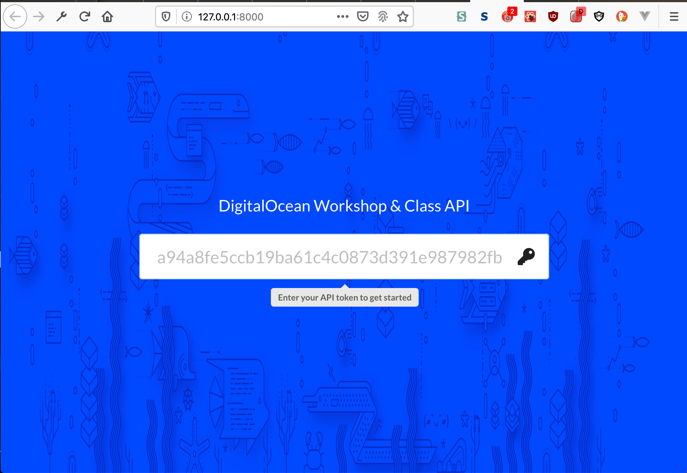

# Cloud Classroom

**Manage DigitalOcean infrastructure for educational purposes with ease and control.**

Cloud Classroom is a modern web application that serves as an API proxy between DigitalOcean infrastructure and students, giving teachers complete control over cloud resources while providing students hands-on experience with real cloud computing environments.



## 🎯 Purpose

Current limitations of the DigitalOcean UI and IAM system pose significant challenges for educators trying to use DigitalOcean in the classroom:

- **Credit Card Requirements**: Not all students have credit cards, creating barriers to access
- **Age Restrictions**: Primary and secondary school students often can't legally create accounts
- **Resource Management**: No centralized control over student resource usage and costs
- **Security Concerns**: Students need direct access to production cloud accounts

Cloud Classroom solves these problems by providing a secure, controlled environment where teachers manage the infrastructure while students get hands-on cloud experience.

## ✨ Key Features

### For Teachers
- 🏫 **Class Management** - Create and manage multiple classes with different configurations
- 👥 **Student Oversight** - Monitor all student droplets and resource usage
- 💰 **Cost Control** - Set limits on droplet sizes, regions, and quantities per student
- 🔐 **SSH Key Management** - Automatically inject teacher SSH keys for support and oversight
- 📊 **Usage Analytics** - Track resource usage across all classes and students

### For Students
- 💻 **Easy Droplet Management** - Create, start, stop, and delete virtual machines with one click
- 🔗 **Instant Access** - Get SSH credentials and connection info immediately
- 🎓 **Class-Based Resources** - Access droplets configured specifically for each class
- 📱 **Mobile-Friendly** - Responsive interface works on all devices

### Technical Highlights
- ⚡ **Modern Stack** - Django 5.0, HTMX, Tailwind CSS, and async Python
- 🔒 **Secure by Default** - Role-based access control and CSRF protection
- 🚀 **Real-Time Updates** - HTMX-powered interface with no page reloads
- 🌐 **Async Operations** - Modern aiohttp-based DigitalOcean API client
- 🧪 **Well Tested** - Comprehensive test suite with async support

## 🚀 Quick Start

### Prerequisites
- Python 3.12+
- DigitalOcean API token
- Email service (for account verification)

### Installation

1. **Clone the repository**
   ```bash
   git clone https://github.com/MasonEgger/cloud-classroom.git
   cd cloud-classroom
   ```

2. **Set up Python environment with uv**
   ```bash
   # Install uv if you haven't already
   curl -LsSf https://astral.sh/uv/install.sh | sh
   
   # Create virtual environment and install dependencies
   uv sync
   ```

3. **Configure environment variables**
   ```bash
   cp env.example .env
   # Edit .env with your configuration
   ```

4. **Required environment variables**
   ```bash
   # Django Configuration
   DJANGO_SECRET_KEY=your-secret-key-here
   DEBUG=True
   DEVELOPMENT_MODE=True
   DJANGO_ALLOWED_HOSTS=127.0.0.1,localhost
   
   # DigitalOcean API
   DO_TOKEN=your-digitalocean-api-token
   
   # Database (optional - uses SQLite by default in dev)
   DB_NAME=cloud_classroom
   DB_USER=postgres
   DB_PASSWORD=your-password
   DB_HOST=localhost
   DB_PORT=5432
   
   # Email Configuration (optional for development)
   EMAIL_HOST=smtp.gmail.com
   EMAIL_PORT=587
   EMAIL_USE_TLS=True
   EMAIL_HOST_USER=your-email@gmail.com
   EMAIL_HOST_PASSWORD=your-app-password
   ```

5. **Initialize the database**
   ```bash
   uv run python manage.py migrate
   uv run python manage.py createsuperuser
   ```

6. **Start the development server**
   ```bash
   uv run python manage.py runserver
   ```

7. **Access the application**
   - Open http://127.0.0.1:8000
   - Sign up for an account or use the superuser account
   - Configure your first class in the Django admin

## 📚 User Guide

### For Teachers

#### Setting Up Your First Class

1. **Create Teacher Account**
   - Sign up through the web interface
   - Access Django admin at `/admin/` with superuser credentials
   - Create a Teacher object linked to your user account

2. **Configure Class Settings**
   ```python
   # Example class configuration
   Class(
       name="Introduction to Cloud Computing",
       prefix="CS101",  # Used in droplet naming
       droplet_image="ubuntu-22-04-x64",
       droplet_size="s-1vcpu-1gb",
       droplet_region="nyc1",
       droplet_student_limit=2,  # Max droplets per student
       force_teacher_ssh_key=True,  # Inject your SSH key
   )
   ```

3. **Add Students**
   - Create Student objects in Django admin
   - Associate students with your classes
   - Students can then sign up and be linked to their accounts

#### Managing Student Resources

- **Dashboard Overview**: Monitor all classes and droplet usage
- **Class Detail View**: See all droplets for a specific class
- **Student Oversight**: View and manage individual student droplets
- **Resource Control**: Set limits and policies per class

### For Students

#### Getting Started

1. **Account Setup**
   - Sign up with your email address
   - Verify your email (if email is configured)
   - Your teacher will associate you with classes

2. **Managing Droplets**
   - **Create**: Click "Create Droplet" in any class you're enrolled in
   - **Connect**: Use the SSH credentials provided in the connection modal
   - **Control**: Start, stop, reboot, or delete droplets as needed

3. **Accessing Your Virtual Machines**
   ```bash
   # SSH into your droplet
   ssh student@your-droplet-ip
   
   # Use the password shown in the connection info
   # Change the password after first login for security
   ```

#### Best Practices

- **Security**: Change your droplet password after first login
- **Resource Management**: Delete droplets when finished to stay within limits
- **Backup Important Work**: Droplets are ephemeral - save important files elsewhere

## 🛠 Development

### Modern Development Stack

Cloud Classroom uses a modern Python web development stack:

- **Django 5.0** - Web framework with async support
- **HTMX** - Dynamic HTML without complex JavaScript
- **Tailwind CSS** - Utility-first CSS framework
- **Alpine.js** - Minimal JavaScript for interactions
- **aiohttp** - Async HTTP client for DigitalOcean API
- **pydantic** - Data validation and serialization
- **pytest** - Testing framework with async support

### Development Setup

1. **Install development dependencies**
   ```bash
   uv sync --extra dev
   ```

2. **Run tests**
   ```bash
   uv run pytest
   ```

3. **Code quality checks**
   ```bash
   uv run ruff check .
   uv run ruff format .
   ```

4. **Type checking**
   ```bash
   uv run mypy .
   ```

### Project Structure

```
cloud-classroom/
├── classroom/          # Main classroom management app
├── classes/            # Class model and logic
├── droplet/            # Droplet model and management commands
├── services/           # Async external service clients
├── students/           # Student model and logic
├── teachers/           # Teacher model and logic
├── users/              # User authentication and profiles
├── templates/          # HTML templates
├── tests/              # Test suite
├── static/             # Static files
└── do_classroom/       # Django project settings
```

### API Architecture

Cloud Classroom uses a modern async architecture:

```python
# Async DigitalOcean client
async with DigitalOceanClient() as client:
    droplets = await client.list_droplets()
    
# Classroom service layer
async with ClassroomService() as service:
    droplet, info = await service.create_droplet_for_student(class_obj, student)
```

## 🧪 Testing

Run the comprehensive test suite:

```bash
# Run all tests
uv run pytest

# Run with coverage
uv run pytest --cov=.

# Run specific test categories
uv run pytest tests/test_models.py
uv run pytest tests/test_digitalocean_service.py
uv run pytest tests/test_classroom_service.py
```

The test suite includes:
- **Unit tests** for models and utilities
- **Async tests** for service layer
- **Integration tests** for views and templates
- **Mock tests** for external API calls

## 📦 Deployment

### Production Deployment

1. **Environment Configuration**
   ```bash
   DEBUG=False
   DEVELOPMENT_MODE=False
   DJANGO_ALLOWED_HOSTS=your-domain.com
   DJANGO_SECRET_KEY=production-secret-key
   ```

2. **Database Setup**
   ```bash
   # Use PostgreSQL in production
   DB_NAME=cloud_classroom_prod
   DB_USER=cloud_classroom
   DB_PASSWORD=secure-password
   DB_HOST=your-db-host
   DB_PORT=5432
   ```

3. **Static Files**
   ```bash
   uv run python manage.py collectstatic
   ```

4. **WSGI Server**
   ```bash
   # Use gunicorn for production
   uv run gunicorn do_classroom.wsgi:application
   ```

### Docker Deployment

```dockerfile
FROM python:3.12-slim

WORKDIR /app
COPY . .

RUN pip install uv
RUN uv sync --frozen

EXPOSE 8000
CMD ["uv", "run", "gunicorn", "do_classroom.wsgi:application"]
```

## 🔧 Configuration

### DigitalOcean Integration

Cloud Classroom requires a DigitalOcean API token with the following permissions:
- **Droplet management** - Create, read, update, delete droplets
- **Region and size listing** - Read available resources
- **SSH key management** - Manage SSH keys for droplets

### Email Configuration

For production use, configure email for account verification:

```python
# Gmail example
EMAIL_HOST = 'smtp.gmail.com'
EMAIL_PORT = 587
EMAIL_USE_TLS = True
EMAIL_HOST_USER = 'your-email@gmail.com'
EMAIL_HOST_PASSWORD = 'your-app-password'
```

### Security Settings

Recommended production security settings:

```python
SECURE_BROWSER_XSS_FILTER = True
SECURE_CONTENT_TYPE_NOSNIFF = True
SECURE_HSTS_INCLUDE_SUBDOMAINS = True
SECURE_HSTS_SECONDS = 86400
SECURE_SSL_REDIRECT = True
SESSION_COOKIE_SECURE = True
CSRF_COOKIE_SECURE = True
```

## 🤝 Contributing

We welcome contributions! Please see our contributing guidelines:

1. **Fork the repository**
2. **Create a feature branch** (`git checkout -b feature/amazing-feature`)
3. **Make your changes** with tests
4. **Run the test suite** (`uv run pytest`)
5. **Check code quality** (`uv run ruff check .`)
6. **Commit your changes** (`git commit -m 'Add amazing feature'`)
7. **Push to the branch** (`git push origin feature/amazing-feature`)
8. **Open a Pull Request**

### Development Guidelines

- **Write tests** for new functionality
- **Follow PEP 8** style guidelines (enforced by ruff)
- **Add type hints** for all new code
- **Update documentation** for user-facing changes
- **Test async code** properly with pytest-asyncio

## 📜 License

This project is licensed under the MIT License - see the [LICENSE](LICENSE) file for details.

## 🙏 Acknowledgments

- **DigitalOcean** for providing the cloud infrastructure platform
- **Django** community for the excellent web framework
- **HTMX** for making dynamic web apps simple
- **Educational community** for inspiring this tool

## 📞 Support

- **Issues**: [GitHub Issues](https://github.com/MasonEgger/cloud-classroom/issues)
- **Discussions**: [GitHub Discussions](https://github.com/MasonEgger/cloud-classroom/discussions)
- **Documentation**: Check the wiki for additional guides

---

**Built with ❤️ for educators and students learning cloud computing**